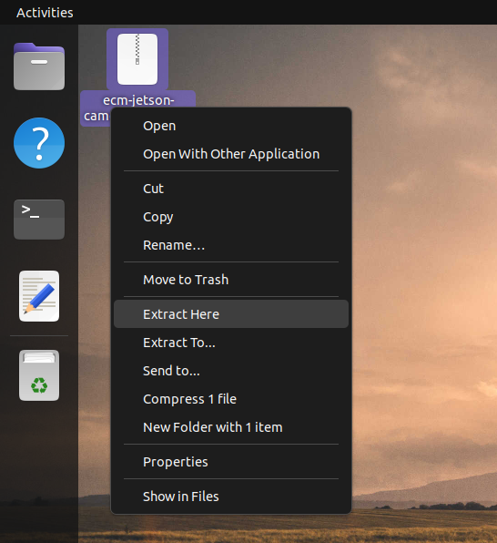
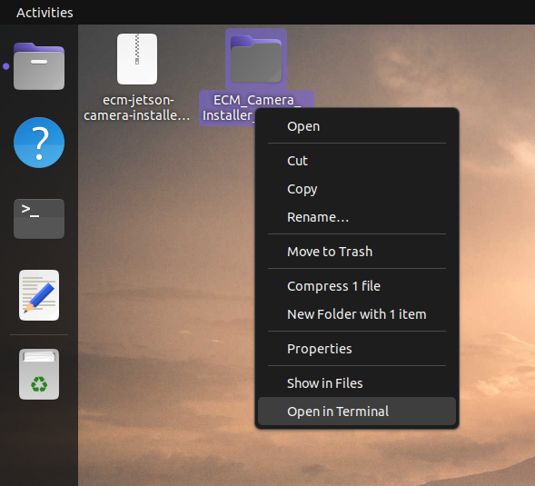
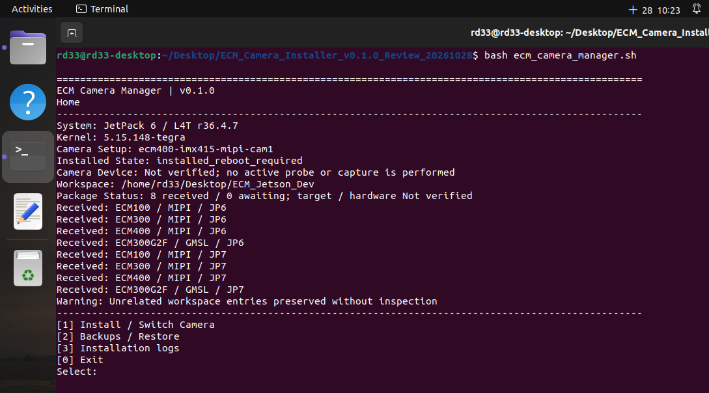

# ECM Jetson Camera Installer

Version: **v0.1.0**

## Purpose and Current Status

ECM Jetson Camera Installer provides a unified installation entry point for NVIDIA Jetson camera driver packages, including package selection, installation confirmation, backup and restore, and installation logs.

The installer uses prebuilt `.ko`, `.dtbo`, and supporting ISP/NITO files. Users do not need to compile drivers. This package provides installation-related functions only; it does not include preview, photo capture, or sensor source code.

Four JetPack 7.x packages are currently included and have passed local simulated installation, backup/restore, and package-switching checks. The home and package confirmation pages are available for review. **Installation and restore on a real device are not yet enabled, and board validation is still pending.**

## Models and Packages

| Model | Sensor | Connection | JetPack 7.x |
|---|---|---|---|
| TS-ECM100M22 | GC2093 | MIPI | Included |
| TS-ECM300M22 | IMX675 | MIPI | Included |
| TS-ECM300G2F | IMX675 | GMSL (MAX96724) | Included |
| TS-ECM400G2F | IMX415 | GMSL (MAX96724) | Included |

“Included” means the package files are present and have passed integrity checks and local simulation. It does not mean that installation or image capture has been verified on a real device.

Packages are organized by product family, connection, and JetPack version. GMSL packages also identify the serializer/deserializer pair. For example, ECM300 MIPI uses `packages/ecm300/mipi/jp7/`, while ECM300G2F uses `packages/ecm300/gmsl/max96717-max96724/jp7/`. Both belong to the ECM300 product family; their package identities remain separate. ECM400G2F uses `packages/ecm400/gmsl/max96717-max96724/jp7/` and package ID `ecm400-gmsl-max96724-jp7`. The previous ECM400 MIPI JP7 package is no longer offered; its historical transaction identity is preserved for restore and is never redirected to GMSL. JP6 remains outside this public candidate. The ECM400 MIPI JP6 identity is retained for internal/history use but hidden from new public installation choices. The home page counts only the seven public choices: four received JP7 packages and three awaiting JP6 packages; no ECM400G2F JP6 package is introduced. See the [directory guide](docs/structure.md).

The included JP7 binaries identify their target kernel as `6.8.12-1021-tegra`. The exact L4T version, supported board models, and hardware compatibility remain to be confirmed; the JetPack major version alone is not sufficient to establish compatibility.

### Resolutions and FPS

The following specifications are declared by the included **JetPack 7.x** packages. All listed modes are **Linear**; HDR is outside the scope of this package. FPS values are mode settings; actual frames and frame rates will continue to be validated on hardware.

| Model | Connection | Resolutions and FPS |
|---|---|---|
| TS-ECM100M22 | MIPI | 1920×1080 @ 60/30 FPS; 1280×720 @ 60/30 FPS |
| TS-ECM300M22 | MIPI | 2592×1944 @ 80/60/30 FPS; 2560×1440 @ 60/30 FPS; 1920×1080 @ 60/30 FPS |
| TS-ECM300G2F | GMSL (MAX96724) | 2592×1944 @ 80/60/30 FPS; 2560×1440 @ 60/30 FPS; 1920×1080 @ 60/30 FPS |
| TS-ECM400G2F | GMSL (MAX96724) | 3840×2160 @ 30 FPS; 2560×1440 @ 60/30 FPS; 1920×1080 @ 90/60/30 FPS |

The ECM300G2F GMSL package is fixed to upstream commit `66e13ae803064226ff489a70b0a52c190f87b4af`. Channels A/B/C/D each declare the same seven Linear modes and share one ISP/NITO pair. Mode6 is 1920×1080 at **30 FPS**, as declared by the effective driver mode table, DTS values, and compiled DTBO; the upstream README incorrectly lists 60 FPS. These static checks do not prove source-to-binary build provenance or hardware performance. Simultaneous multi-channel capture still requires validation.

The ECM400G2F GMSL package is fixed to upstream commit `f987e61f1880d4bcf33033235d4d692e210c00ef`. Its compiled overlay configures **one camera channel**, VC0, four lanes, and `serial_c`, with six Linear modes. The deserializer's `max-src = 4` value does not configure four cameras. This package does not declare 3840×2160 at 60 FPS. Physical connector mapping and actual capture still require hardware validation.

See the [JetPack 7.x resolution and mode reference](docs/resolutions.md). This package does not include preview code that performs capture or cropping.

## Requirements and Startup

### Requirements

- NVIDIA Jetson Orin Nano / Orin NX running Linux on AArch64.
- Bash and Python 3.10 or later. The program uses the Python standard library.
- The complete installer directory, including the program, package index, and binaries under `packages/`.
- A writable workspace for installation logs, backups, and reports.

### Open the Menu

**1. Extract the package.**

Right-click the downloaded `.tar.gz` archive and select **Extract Here**.



**2. Open a terminal in the installer folder.**

Right-click the extracted installer folder and select **Open in Terminal**. Use the folder that contains `ecm_camera_manager.sh`.



**3. Open the menu.**

Run the following command in that terminal:

```bash
bash ecm_camera_manager.sh
```



Historical menu layout example captured from an internal eight-package test build before the ECM400G2F replacement; product names and counts in the image are not the current package list. This repository currently includes the four JP7 packages listed in **Models and Packages** above. Displayed installation messages depend on the selected workspace and do not confirm completed installation.

To display the installer version, run `bash ecm_camera_manager.sh --version`. The archive is named `ecm-jetson-camera-installer-v0.1.0.tar.gz`.

The program automatically checks the workspace. If it finds exactly one recognized existing workspace, it reuses its records without moving or merging old data. If no existing workspace is found, the default is `$HOME/ECM_Camera_Workspace`.

If multiple workspaces are detected, use `--workspace` to select the directory to reuse. Replace the following path with the actual location:

```bash
bash ecm_camera_manager.sh --workspace "/path/to/existing-workspace"
```

### Workflow

1. Open the home page to review the current environment and package status.
2. Select **Install / Switch Camera**. The program detects JetPack from the environment and offers manual selection when detection is unavailable.
3. Select the model and its MIPI/GMSL package.
4. Review the selected package, environment differences, and planned actions on the installation confirmation page.

The current version allows review through the installation confirmation page; writing to a real device is not yet enabled. Environment differences produce warnings and are logged. Missing or corrupted package files stop the operation. The program does not reboot automatically.

Installation logs are stored in `<workspace>/logs/external/`, and exported summaries are stored in `<workspace>/reports/`. Select **Installation logs** on the home page to view records.

See the [directory guide](docs/structure.md) for the purpose of each folder.

See the [CHANGELOG](CHANGELOG.md) for version changes. Final terms and external distribution remain subject to company approval.
