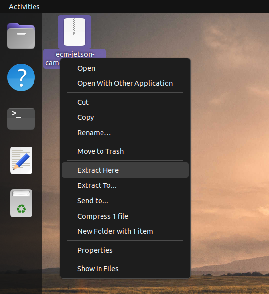
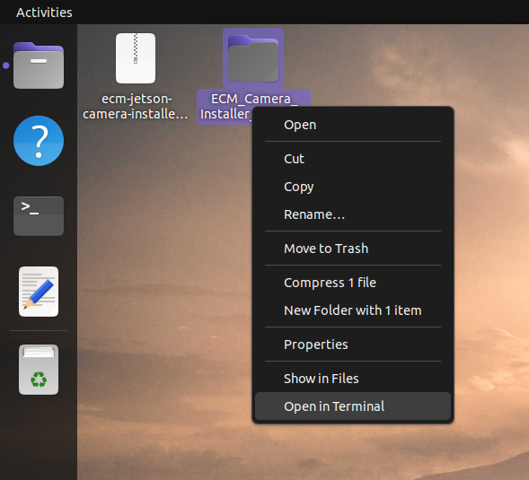
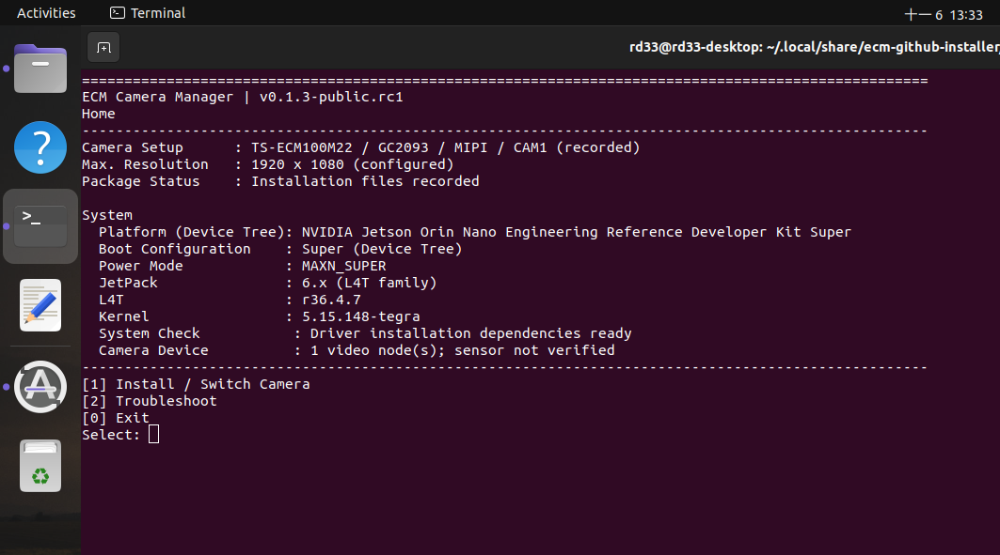
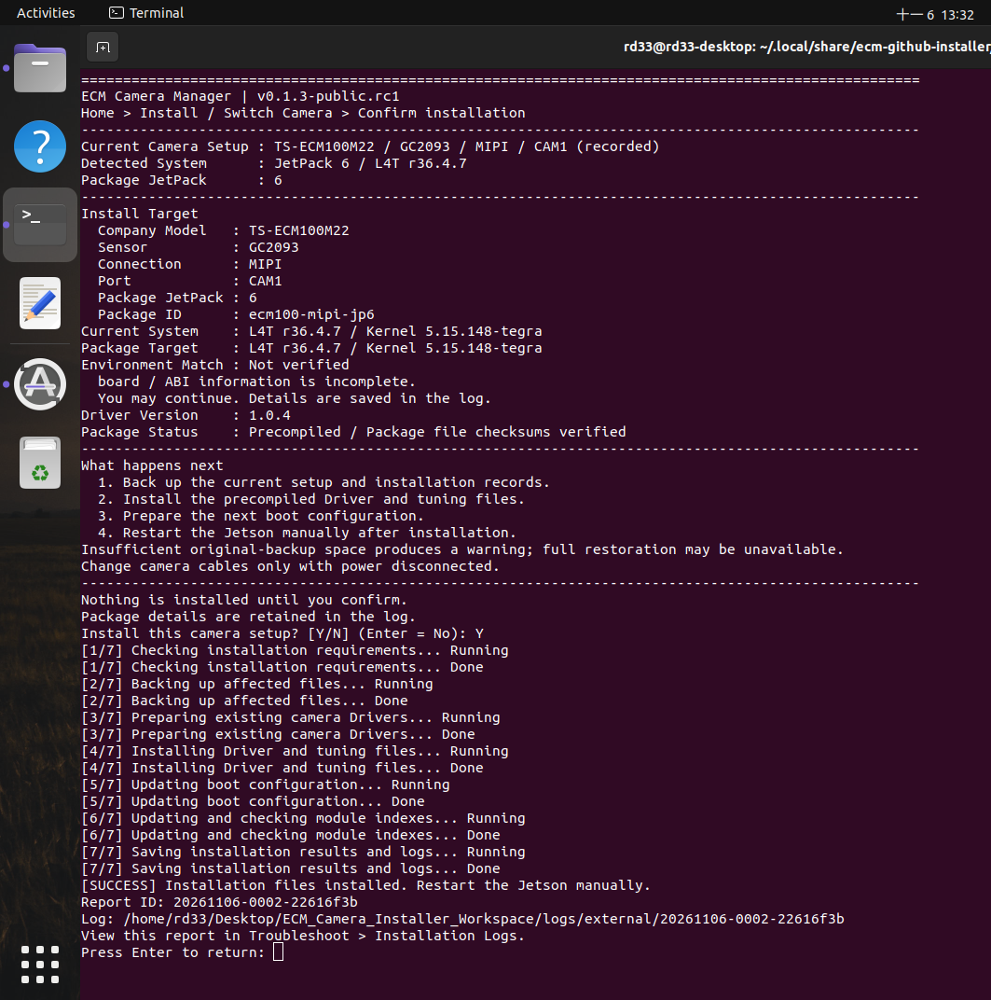

# ECM Camera Manager

Local public candidate v0.1.3-public.rc1 for NVIDIA Jetson. The Manager installs precompiled camera drivers, tuning files and the boot configuration for the selected package.

| Company model | Sensor | Connection and port | JetPack 6 package | JetPack 7 package |
| --- | --- | --- | --- | --- |
| TS-ECM100M22 | GC2093 | MIPI, CAM1 | `ecm100-mipi-jp6` | `ecm100-mipi-jp7` |
| TS-ECM300M22 | IMX675 | MIPI, CAM1 | `ecm300-mipi-jp6` | `ecm300-mipi-jp7` |
| TS-ECM300G2F / TS-ECM301G2F | IMX675 | GMSL, MAX96717 / MAX96724, A–D | `ecm300-gmsl-max96724-jp6` | `ecm300-gmsl-max96724-jp7` |
| TS-ECM300G2F / TS-ECM301G2F | IMX675 | GMSL, MAX96717 / MAX9296, A–B | `ecm300-gmsl-max9296-jp6` | `ecm300-gmsl-max9296-jp7` |
| TS-ECM400G2F | IMX415 | GMSL, MAX96717 / MAX96724, single channel / VC0 | `ecm400-gmsl-max96724-jp6` | `ecm400-gmsl-max96724-jp7` |
| TS-ECM400G2F | IMX415 | GMSL, MAX96717 / MAX9296, A–B | `ecm400-gmsl-max9296-jp6` | `ecm400-gmsl-max9296-jp7` |

These 12 packages cover six configurations on each JetPack version. The GMSL routes above come from the packaged overlays. Physical port mapping and operation on hardware are pending verification for this candidate.

The JP6 artifacts target kernel `5.15.148-tegra` and the JP7 artifacts target `6.8.12-1021-tegra`. Review the detected host and declared package target on the confirmation screen. Each manifest records the target fields available for that package.

## Start the Manager for the first time

**1. Extract the archive.** On your Jetson, right-click the downloaded `.tar.gz` file and choose **Extract Here**.



**2. Open a terminal.** Right-click the extracted folder that contains `ecm_camera_manager.sh` and choose **Open in Terminal**.



**3. Open the menu.** Run the following command and enter your password at the native sudo prompt if asked.

```bash
bash ecm_camera_manager.sh
```



## Install the driver

Choose **Install / Switch Camera** and select the model family and connection. For GMSL, choose **MAX96717 / MAX96724** or **MAX96717 / MAX9296** to match your hardware. Review the package ID and JetPack target on the confirmation screen. Press **Enter** or **N** to cancel. Enter **Y** to start the seven installation stages.

The installer backs up affected files, takes over eligible older drivers, writes the selected package and boot configuration, updates module indexes and saves the result. The example below shows all seven stages completed for an ECM100 MIPI on JetPack 6. The success message confirms that the files were installed.



After a successful installation, restart the Jetson manually. Disconnect power before changing camera cables.

## Troubleshoot

**Installation Logs** opens saved installation reports. Match the Report ID shown in the terminal with `logs/external/<report-id>/` in the workspace.

**Environment Check** checks system Python and driver installation tools. On a matching Ubuntu/arm64/L4T profile, missing-package repair can prepare a reviewed plan. Installing the plan requires separate confirmation. The bundled repair profiles target Ubuntu 22.04 / R36.4.7 and Ubuntu 24.04 / R39.2.1.

If space runs out while saving an original file, the installer can continue with a warning. The report identifies the originals unavailable for restoration. A required file write failure stops the installation and records recovery status. If the boot configuration update fails, keep the Jetson running, read the report and select the same package to repair the partial installation.

## Reference

- [Resolution and mode reference](docs/resolutions.md)
- [Directory guide](docs/structure.md)
- [Changelog](CHANGELOG.md)
